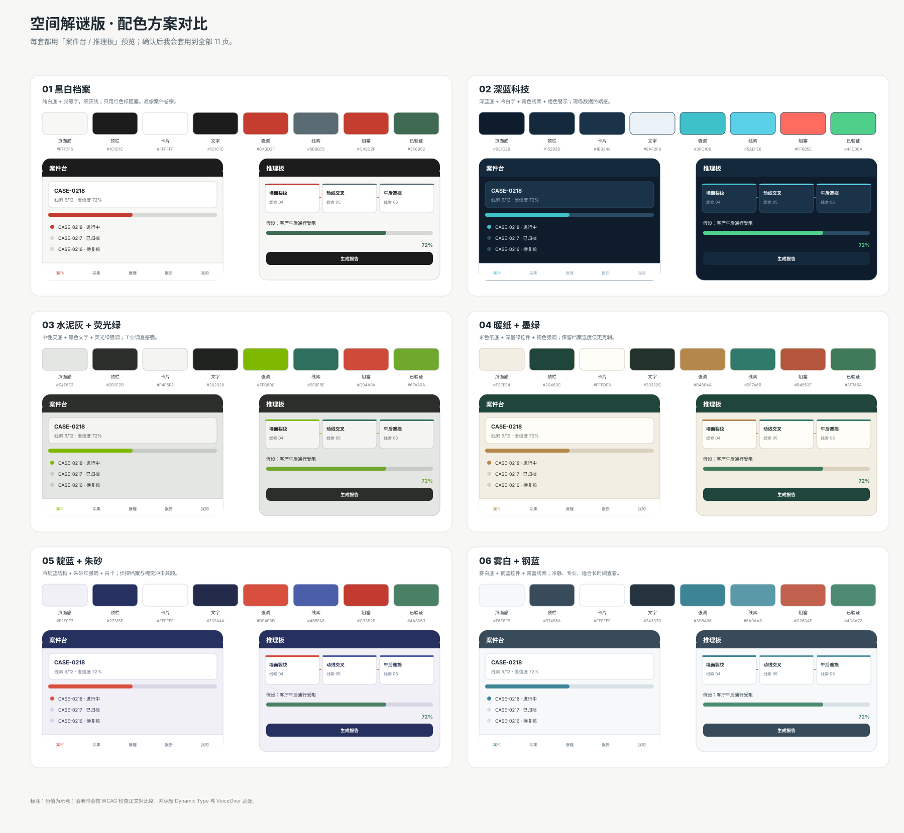

# 空间解谜版 · 配色方案对比（2026-11-28）

当前正式设计图使用的是「暖纸 + 深墨 + 证据金 + 线索青」。下面先给 6 套可选配色（**已选 05 靛蓝 + 朱砂，并已应用到正式设计图**），每套都用「案件台 / 推理板」做了预览；确认后再套用到全部 11 页。

## 01 黑白档案

- **定位**：纯白底 + 炭黑字 + 细灰线，仅用红色标阻塞。
- **色值**：页面底 `#F7F7F5` / 顶栏 `#1C1C1C` / 卡片 `#FFFFFF` / 强调 `#C43D2F` / 线索 `#5B6B73` / 已验证 `#3F6B52`
- **优点**：最像案件卷宗，克制、专业、打印友好。
- **风险**：长时间看容易偏冷偏硬，需要靠层级和字重撑起层次。

## 02 深蓝科技

- **定位**：深蓝底 + 冷白字 + 青色线索 + 橙色警示。
- **色值**：页面底 `#0E1C2B` / 顶栏 `#15293D` / 卡片 `#1B3348` / 强调 `#3FC1C9` / 线索 `#5AD1E6` / 阻塞 `#FF6B5E` / 已验证 `#4FD08A`
- **优点**：现场数据终端感强，适合 AR / LiDAR 场景。
- **风险**：深色模式需单独处理强光可读性，纸面报告导出要另做浅色版。

## 03 水泥灰 + 荧光绿

- **定位**：中性灰底 + 黑色文字 + 荧光绿强调。
- **色值**：页面底 `#E4E6E3` / 顶栏 `#2B2E2B` / 卡片 `#F4F5F2` / 强调 `#7FB800` / 线索 `#2E6F5E` / 阻塞 `#D04A3A`
- **优点**：工业调查感最强，荧光绿在灰色环境里非常醒目。
- **风险**：荧光绿大面积使用容易刺眼，建议只用在状态与关键动作。

## 04 暖纸 + 墨绿

- **定位**：米色纸底 + 深墨绿控件 + 铜色强调。
- **色值**：页面底 `#F3EEE4` / 顶栏 `#20463C` / 卡片 `#FFFDF8` / 强调 `#B4884A` / 线索 `#2F7A6B` / 阻塞 `#B4553E`
- **优点**：保留档案温度，比当前方案更克制、更像工具书。
- **风险**：与当前正式版差异不算最大，升级感偏弱。

## 05 靛蓝 + 朱砂

- **定位**：冷靛蓝结构 + 朱砂红强调 + 白卡。
- **色值**：页面底 `#F2F0F7` / 顶栏 `#27315F` / 卡片 `#FFFFFF` / 强调 `#D94F3D` / 线索 `#4B5FA8` / 已验证 `#4A8063`
- **优点**：侦探档案气质与视觉冲击兼顾，红色强调非常有记忆点。
- **风险**：朱砂红容易被误读为“警告”，需限制在强调与关键动作。

## 06 雾白 + 钢蓝

- **定位**：雾白底 + 钢蓝控件 + 青蓝线索。
- **色值**：页面底 `#F6F8F9` / 顶栏 `#374B5A` / 卡片 `#FFFFFF` / 强调 `#3D8496` / 线索 `#5A9AA8` / 已验证 `#4D8A72`
- **优点**：冷静、专业，适合长时间查看和 iPad 分屏。
- **风险**：辨识度相对温和，需要靠版式和图标强化品牌感。

## 建议

- 想要**最像案件档案**：选 01 黑白档案。
- 想要**现场科技感**：选 02 深蓝科技。
- 想要**强视觉冲击**：选 03 水泥灰 + 荧光绿 或 05 靛蓝 + 朱砂。
- 想要**稳妥耐看**：选 06 雾白 + 钢蓝。
- 想要**温和延续**：选 04 暖纸 + 墨绿。

我个人更推荐 **01 黑白档案** 或 **06 雾白 + 钢蓝**：前者最贴合“空间解谜”，后者最适合长期使用。确认后我再把选定配色套到全部 11 页。

## 校验说明

- SVG 已通过 XML 校验并渲染检查，6 套配色预览均完整清晰。
- 落地时会按 WCAG 检查正文对比度，并保留 Dynamic Type 与 VoiceOver 适配。
