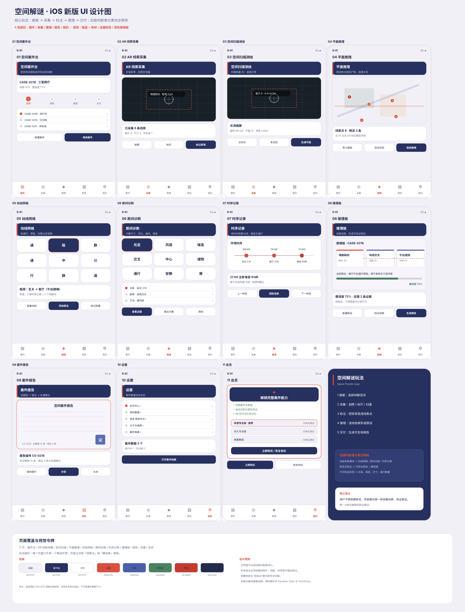

# 空间解谜版 iOS UI 设计（2026-11-28）

新版把核心玩法从「看结论」改为**空间解谜**：用户像侦探一样接案、采集线索、回到平面推理、验证假设，最后交付可复核报告。所有占卜 / 命理类元素已完全移除。

**当前配色：靛蓝 + 朱砂**：页面底 `#F2F0F7` / 顶栏 `#27315F` / 朱砂强调 `#D94F3D` / 靛蓝线索 `#4B5FA8` / 已验证 `#4A8063` / 阻塞 `#C33B2E`。



## 核心玩法循环

```text
接案 → 采集 → 标注 → 推理 → 交付
```

| 阶段 | 用户动作 | 对应页面 |
| --- | --- | --- |
| 接案 | 选择一个待解空间问题 | 空间案件台 |
| 采集 | 拍照、测量、LiDAR 扫描 | AR 线索采集 / 空间扫描测绘 |
| 标注 | 把异常变成可追踪的线索点 | 平面推理 |
| 推理 | 连接线索、形成假设、看置信度 | 动线网格 / 房间诊断 / 时序记录 / 推理板 |
| 交付 | 生成带证据链的处理建议 | 案件报告 |

## 11 个页面

1. 空间案件台
2. AR 线索采集
3. 空间扫描测绘
4. 平面推理
5. 动线网格
6. 房间诊断
7. 时序记录
8. 推理板
9. 案件报告
10. 设置
11. 会员

## 旧模块 → 新模块映射

| 旧模块 | 新模块 | 变化 |
| --- | --- | --- |
| 玄空九宫 | 动线网格 | 从飞星吉凶改为通行 / 停留 / 阻塞的观察网格 |
| 八宅 / 三合 | 房间诊断 | 从命卦宜忌改为采光、通风、噪音、尺寸评估 |
| 紫白 / 奇门择时 | 时序记录 | 从吉日神煞改为一天内光线、噪音、通行变化 |
| 天机书 | 案件报告 | 从结论长卷改为证据链 + 假设 + 处理建议 |
| 专业详情 | 推理板 | 从传统依据改为线索连线与置信度 |
| 罗盘 | 已移除 | 方向仅作为 AR / 平面中的坐标属性存在 |

## 设计原则

- 主界面不出现判断类、命理类词汇。
- 所有结论必须挂到照片、测距、时序或平面线索点。
- 用「置信度 / 待验证」替代断言式判断。
- 每个页面只承担解谜循环中的一个步骤。
- 底栏固定五宫：案件 / 采集 / 推理 / 报告 / 我的。

## 视觉语言

- 页面底 `#F2F0F7`，案件板靛蓝 `#27315F`，白卡 `#FFFFFF`。
- 朱砂强调 `#D94F3D`，靛蓝线索 `#4B5FA8`，已验证绿 `#4A8063`，阻塞红 `#C33B2E`。
- 圆角 14，卡片描边 1pt，主按钮靛蓝底白字。
- 保持浅色方案与 Dynamic Type / VoiceOver 可适配。

## 校验说明

- SVG 已通过 XML 语法校验并渲染检查，11 个页面与玩法说明区均完整。
- 已清理 SVG 中旧版判断类术语；设计图只描述新的客观解谜流程。
- 此前所有旧方案文件已删除，当前仅保留本版设计图与本文档。
